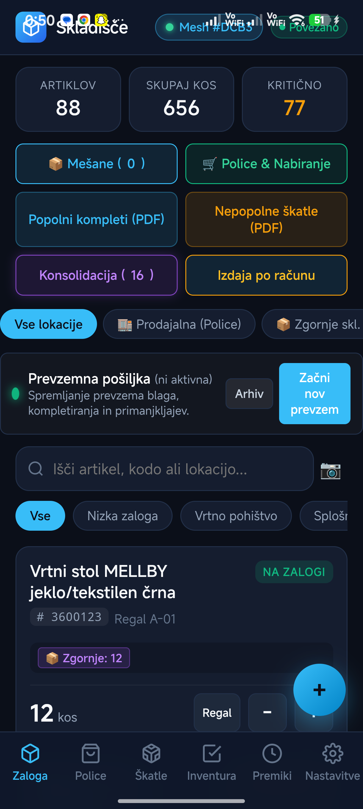
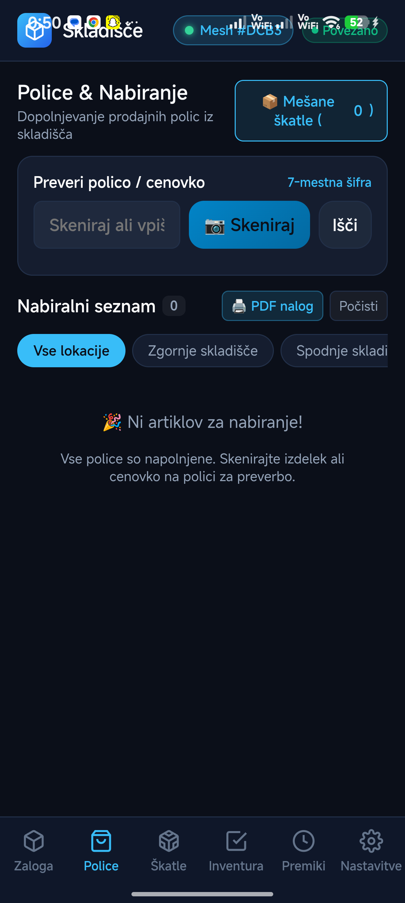
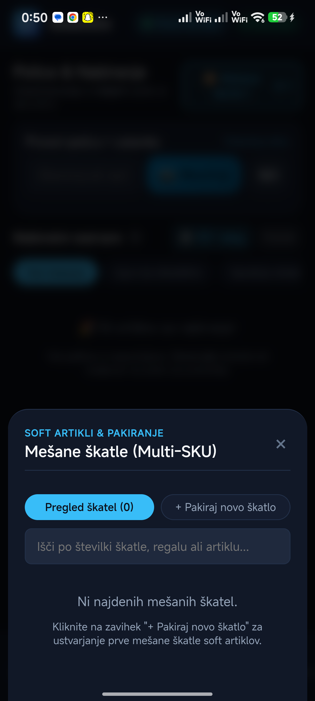
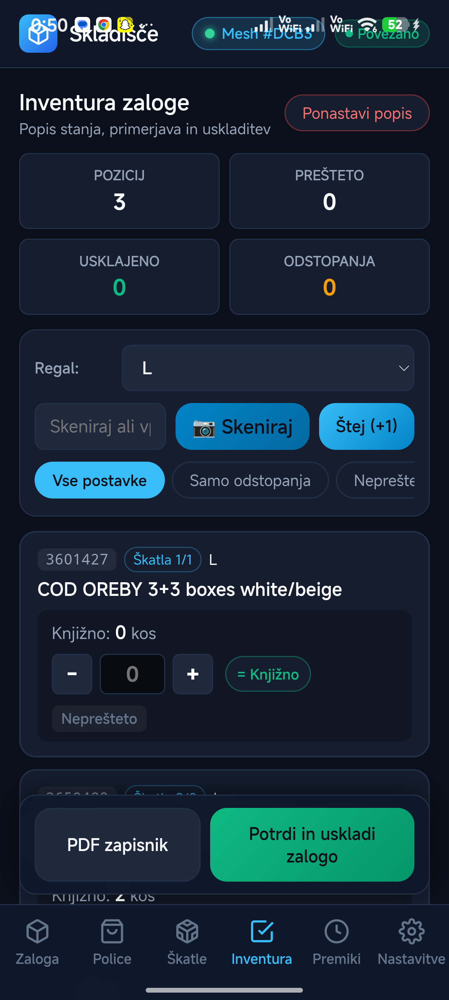
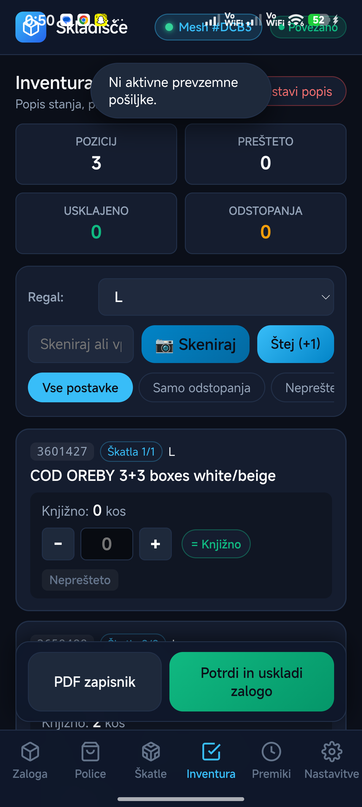
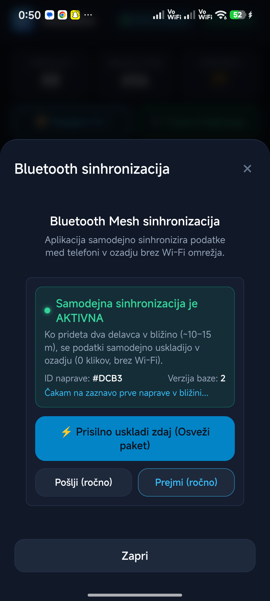

# Skladišče & Trgovina (Android & Offline BLE Mesh aplikacija)

[](Skladisce.apk)
[](#)
[-8b5cf6)](#)
[-brightgreen)](NAVODILA.md)

> 📘 **[ODPRI CELOVITA OPERATIVNA NAVODILA ZA UPORABO (SOP) S POSNETKI ZASLONA](NAVODILA.md)**  
> Podroben priročnik vsakega gumba, funkcije, mešanih škatel, Bluetooth Mesh sinhronizacije in integracije s `storefront.jysk.com`.

**Skladišče & Trgovina** je namensko razvita mobilna aplikacija za celovito vodenje zalog v poslovalnicah maloprodajnih verig (kot je JYSK) v okoljih **brez Wi-Fi povezave**. Združuje napredno optično prepoznavanje etiket (Google ML Kit OCR), sledenje večdelnim pohištvenim garnituram (Škatla 1/2 in 2/2), upravljanje kapacitet polic v trgovini ter **popolnoma samodejno Bluetooth Mesh sinhronizacijo med napravami zaposlenih brez interneta**.

---

## 📸 Posnetki zaslona in moduli aplikacije

| Glavni pregled zaloge | Police in dopolnjevanje | Mešane škatle & Citizen 6×6 |
| :---: | :---: | :---: |
|  |  |  |
| **Inventura po regalih** | **Prevzem pošiljke tovornjaka** | **Bluetooth Mesh status** |
|  |  |  |

---

## ⚡ Ključne zmogljivosti sistema

### 1. Bluetooth Mesh ozadna sinhronizacija (Brez Wi-Fi in brez interneta)
* **Samodejna izmenjava:** Ko delavca (npr. skladiščnik v spodnjem skladišču in prodajalec v trgovini) prideta v doseg Bluetootha (10–15 m), telefona v 3 sekundah samodejno uskladita bazi podatkov brez dotika zaslona.
* **CRDT State Vector & Hash (#XXXX):** Deterministično združevanje hkratnih sprememb brez prepisovanja ali izgube podatkov (+5 kos in -2 kosa = točno +3 kosi na obeh napravah).

### 2. Upravljanje polic v trgovini in kapacitet (Replenishment)
* Spremljanje maksimalne kapacitete posameznih polic (npr. Polica T-05 sprejme 12 kosov).
* **Avtomatski nabiralni nalog:** Ko prodaja izprazni polico, aplikacija samodejno izračuna manko in prodajalcu ponudi seznam potrebnih artiklov z natančno lokacijo v skladišču.
* Enoklikovni prenos: Gumb `Prenesi na polico` avtomatsko razbremeni regal v skladišču in dopolni polico v trgovini.

### 3. Celovitost večdelnih garnitur (Škatla 1/2 in 2/2)
* Podpora za pohištvene komplete, pakirane v več ločenih škatlah.
* Samodejno preverjanje: Artikel je označen kot **POPOLNA GARNITURA** le, če so na zalogi vsi pripadajoči deli.
* Opozorila o nepopolnih škatlah in PDF izpis manjkajočih delov za preprečevanje napačne izdaje kupcem.

### 4. Mešane škatle za soft blago (Multi-SKU) & Tisk nalepk Citizen
* Za artikle, ki niso pakirani posamično (tekstil, blazine, dekorativa).
* Združevanje več različnih šifer v eno mešano škatlo z enolično serijsko številko (npr. `BOX-2026-004`).
* **Tisk etiket Citizen 6×6 cm:** Samodejno generiranje standardizirane PDF nalepke z veliko QR kodo in seznamom vsebine za neposreden tisk na tiskalnik Citizen.

### 5. Prevzemna pošiljka (Razkladanje tovornjaka)
* Hitro skeniranje prispelih palet in škatel.
* Samodejno spajanje novih škatel s starimi zalogami v skladišču (npr. nova škatla 2/2 dopolni obstoječo škatlo 1/2 v kompleten artikel).
* PDF zapisnik prevzema z ločenim pregledom kompletiranih garnitur in primanjkljajev.

### 6. Ultra-HD kamera z Google ML Kit OCR & Čitalnikom kod
* Dvojni način prepoznave: Takojšnje branje 1D črtnih kod (EAN-13, Code 128), QR kod ter optično branje (OCR) 7-mestnih številk artiklov neposredno z nalepk dobaviteljev.
* Integrirana podpora za strojno svetilko (🔦 Luč), digitalni zoom (🔍 1x/2x/3x) in ostrenje na dotik (Tap-to-Focus).

### 7. Hibridna povezava s `storefront.jysk.com`
* **Trgovina (LTE aktiven):** Telefon se neposredno povezuje s JYSK Storefrontom za prevzem dnevnih prodaj z blagajne in napovedanih tovornjakov (ASN).
* **Skladišča (Klet / Ni signala):** Popolnoma avtonomno delovanje z lokalno IndexedDB bazo in Bluetooth Meshom.
* **Store-and-Forward:** Ko delavec stopi nazaj v prodajni prostor, se vsi skladiščni dogodki nemudoma posredujejo v osrednji sistem.

---

## 🛠️ Tehnološki sklad

* **Mobilna platforma:** [Capacitor](https://capacitorjs.com/) (Android Native Wrapper)
* **Jedro aplikacije:** Moderna Vanilla JavaScript arhitektura (brez težkih ogrodij za maksimalno hitrost delovanja na terenskih napravah)
* **Lokalna podatkovna baza:** IndexedDB s transakcijskim dnevnikom in CRDT logiko
* **Bluetooth Mesh:** Nativni Android BLE plugin (`MainActivity.java` z `BluetoothLeAdvertiser` in `BluetoothLeScanner`)
* **Optika & OCR:** Google ML Kit Text Recognition & Barcode Scanning
* **PDF generiranje:** `jspdf.umd.min.js`, `jsbarcode.all.min.js`, `qrcode.min.js`

---

## 📦 Namestitev aplikacije

### Možnost 1: Namestitev APK na telefon Android (Priporočeno)
1. Prenesite namestitveno datoteko **[Skladisce.apk](Skladisce.apk)** na telefon.
2. Na telefonu odprite datoteko in potrdite namestitev (omogočite *Namestitev iz neznanih virov*).
3. Ob prvem zagonu aplikaciji dovolite dostop do **Kamere**, **Bluetootha** in **Lokacije** (zahteva sistema Android za BLE skeniranje v ozadju).

### Možnost 2: Zagon prek Android Debug Bridge (ADB)
Če imate telefon povezan z računalnikom prek USB kabla:
```powershell
# Preverjanje povezane naprave
adb devices

# Namestitev neposredno na telefon
adb install -r Skladisce.apk

# Zagon aplikacije na napravi
adb shell am start -n si.skladisce.app/.MainActivity
```

### Možnost 3: Zagon v brskalniku (PWA način za preizkušanje)
V mapi projekta zaženite lokalni spletni strežnik:
```bash
# Z Node.js:
npx serve .

# Ali s Pythonom:
python -m http.server 8080
```
Odprite `http://localhost:8080` v brskalniku Chrome.

---

## 📂 Struktura projekta

```
sharp-nobel/
├── NAVODILA.md                # Celovit priročnik za zaposlene (SOP) s posnetki zaslona
├── README.md                  # Tehnična dokumentacija projekta
├── Skladisce.apk              # Pripravljen Android namestitveni paket
├── app.js                     # Glavna logika vmesnika, modulov in dogodkov
├── db.js                      # IndexedDB baza, CRDT delta mehanizem in BLE Mesh hash
├── index.html                 # Enotni vmesnik vseh 6 modulov in modalnih oken
├── style.css                  # Tema, prilagojena za industrijske pogoje in temne prostore
├── ocr-parser.js              # Parsiranje 7-mestnih šifer, škatel 1/2 in regalov
├── docs/
│   ├── NAVODILA.md            # Zgodovina in varnostna kopija navodil
│   └── screenshots/           # Posnetki zaslona visoke ločljivosti
└── android/                   # Capacitor Android projekt z nativnimi vtičniki
    └── app/src/main/java/si/skladisce/app/
        └── MainActivity.java  # BLE Mesh ozadni servis (GATT, Advertisements & Scans)
```

---

## 📄 Licenca in interna uporaba

Aplikacija je razvita za interno operativno rabo v maloprodajnih poslovalnicah in skladiščih.  
Verzija sistema: **2.4-BLE-Mesh**.
