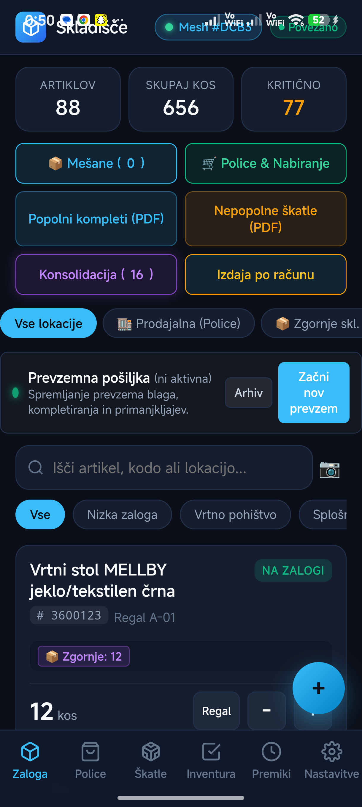
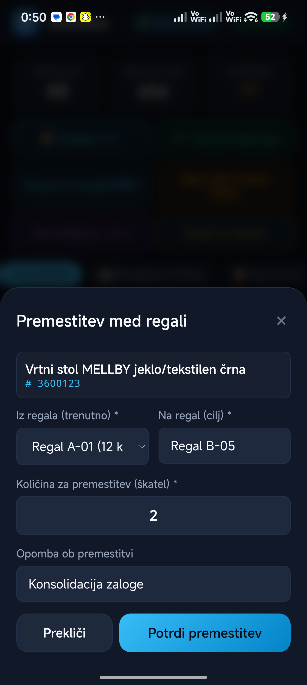
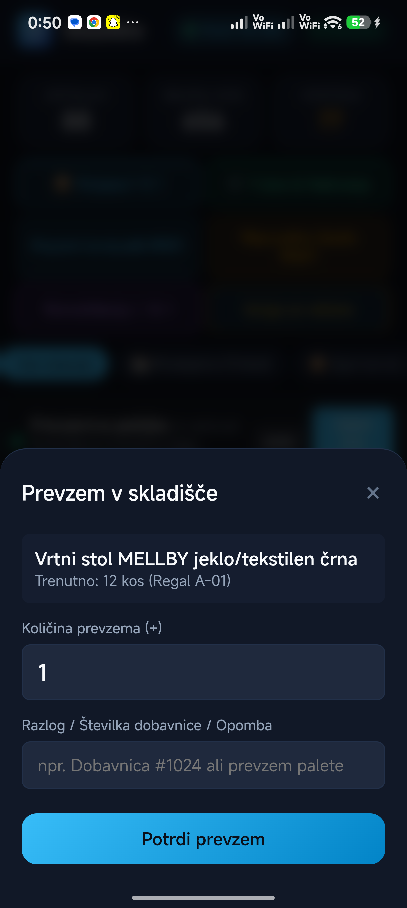
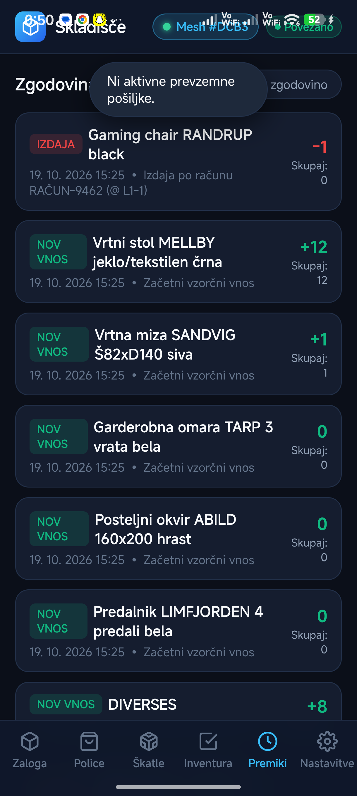
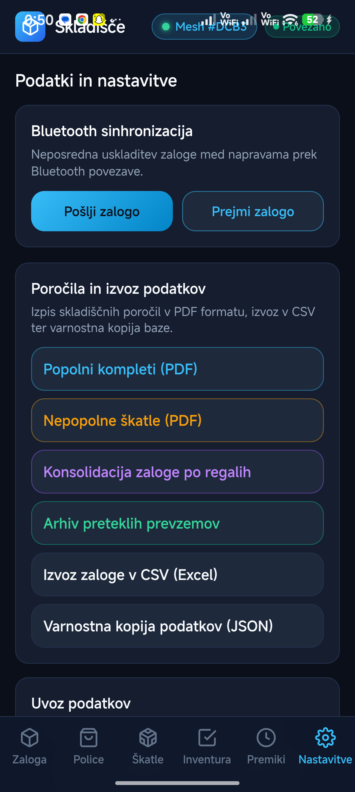

# OPERATIVNA NAVODILA ZA UPORABO APLIKACIJE: SKLADIŠČE & TRGOVINA
**Standard Operating Procedure (SOP) | Celoviti priročnik vseh funkcij in gumbov**

Ta dokument zajema **vsak gumb, stikalo, ikono, vnosno polje in modalno okno** v aplikaciji. Namenjen je operativnemu delu skladiščnikov in prodajalcev v okolju brez Wi-Fi povezave.

---

## KAZALO VSEBINE

1. [Zgornja statusna vrstica (Header) & Bluetooth Mesh](#1-zgornja-statusna-vrstica-header--bluetooth-mesh)
2. [Spodnja navigacijska vrstica (Glavni zavihki)](#2-spodnja-navigacijska-vrstica-glavni-zavihki)
3. [Zavihek 1: Zaloga (Glavni pregled artiklov)](#3-zavihek-1-zaloga-glavni-pregled-artiklov)
4. [Pasica prevzema in Zavihek Prevzemna pošiljka](#4-pasica-prevzema-in-zavihek-prevzemna-pošiljka)
5. [Modal: Arhiv prevzemnih pošiljk](#5-modal-arhiv-prevzemnih-pošiljk)
6. [Modal: Konsolidacija zaloge po regalih](#6-modal-konsolidacija-zaloge-po-regalih)
7. [Modal: Izdaja blaga po računu (Kupci)](#7-modal-izdaja-blaga-po-računu-kupci)
8. [Zavihek 2: Police & Nabiranje (Dopolnjevanje trgovine)](#8-zavihek-2-police--nabiranje-dopolnjevanje-trgovine)
9. [Modal: Mešane škatle za soft blago (Multi-SKU) & Tisk nalepk](#9-modal-mešane-škatle-za-soft-blago-multi-sku--tisk-nalepk)
10. [Zavihek 3: Škatle (Optični čitalnik & OCR skener)](#10-zavihek-3-škatle-optični-čitalnik--ocr-skener)
11. [Zavihek 4: Inventura (Popis zaloge po regalih)](#11-zavihek-4-inventura-popis-zaloge-po-regalih)
12. [Modal: Hitri kamerski skener (Univerzalni vizir)](#12-modal-hitri-kamerski-skener-univerzalni-vizir)
13. [Modal: Dodaj / Uredi artikel](#13-modal-dodaj--uredi-artikel)
14. [Modal: Premestitev med regali](#14-modal-premestitev-med-regali)
15. [Modal: Hitra sprememba zaloge (Izdaja / Prevzem)](#15-modal-hitra-sprememba-zaloge-izdaja--prevzem)
16. [Zavihek 5: Dnevnik premikov (Revizijska sled)](#16-zavihek-5-dnevnik-premikov-revizijska-sled)
17. [Zavihek 6: Nastavitve, Izvozi, Podatki & Lokacije](#17-zavihek-6-nastavitve-izvozi-podatki--lokacije)
18. [Bluetooth Mesh sinhronizacija v praksi (Brez Wi-Fi)](#18-bluetooth-mesh-sinhronizacija-v-praksi-brez-wi-fi)
19. [Hibridna sinhronizacija: LTE v trgovini + BLE v skladišču + JYSK Storefront](#19-hibridna-sinhronizacija-lte-v-trgovini--ble-v-skladišču--jysk-storefront)

---

## 1. ZGORNJA STATUSNA VRSTICA (HEADER) & BLUETOOTH MESH

Zgornja vrstica je trajno prisotna na vseh zaslonih.


### Tabela vseh elementov v glavi

| Element / Gumb | ID / Oznaka | Tip | Točna funkcija / Dejanje |
| :--- | :--- | :--- | :--- |
| **Ikona paketa + Skladišče** | `.logo-area` | Prikaz | Ime in logotip aplikacije. |
| **Gumb BLE Mesh** | `#btnHeaderBLESync` | Gumb | Prikazuje unikatno kontrolno kodo baze (npr. `#DCB3`). Klik odpre diagnostično okno za Bluetooth Mesh povezavo. |
| **Pika stanja BLE** | `#bleHeaderDot` | Indikator | Zelena: BLE aktiven in pripravljen; Utripajoča modra: poteka sinhronizacija; Rdeča: Bluetooth izklopljen. |
| **Indikator povezave** | `#connectionStatus` | Značka | Prikazuje `Brez povezave` (lokalni offline način na telefonu) ali `Povezano`. |

### Diagnostično modalno okno Mesh (klik na gumb BLE Mesh)

| Gumb / Element | ID | Namen / Dejanje |
| :--- | :--- | :--- |
| **Lokalna naprava** | `#bleLocalDevId` | Prikazuje oznako vaše naprave (npr. `DEV-c59d95`). |
| **Stanje baze (Hash)** | `#bleCurrentHash` | 4-mestna hex koda stanja. Če imata dva telefona isti Hash, imata natanko iste podatke. |
| **Prisili uskladitev** | Gumb (moder) | Takoj odda BLE broadcast paket za prisilno uskladitev s telefoni v bližini. |
| **Pošlji zalogo (Ročno)** | Gumb | Preklopi telefon v način oddajanja celotne baze preko BLE GATT strežnika. |
| **Prejmi zalogo (Ročno)** | Gumb | Preklopi telefon v način sprejemanja celotne baze od drugega telefona. |
| **✕ Zapri / Prekliči** | `#btnCloseBLESyncModal` | Zapre diagnostično okno. |

---

## 2. SPODNJA NAVIGACIJSKA VRSTICA (GLAVNI ZAVIHKI)

Na dnu zaslona je 6 glavnih navigacijskih gumbov:

| Gumb | Ikona | Ciljni zavihek | Namen |
| :--- | :--- | :--- | :--- |
| **Zaloga** | Paket | `#tab-inventory` | Seznam vseh artiklov, filtri skladišč, statistika, hitri PDF-ji in pasica prevzema. |
| **Police** | Nakupovalni voziček | `#tab-replenishment` | Nabiranje artiklov za police v trgovini glede na kapaciteto police. |
| **Škatle** | Škatla s črtami | `#tab-scanner` | Glavni skener kamere z OCR prepoznavo etiket, škatel 1/2 in 2/2 ter QR kod. |
| **Inventura** | Kljukica na seznamu | `#tab-audit` | Popis zaloge po regalih, primerjava s knjižnim stanjem in uskladitev. |
| **Premiki** | Ura z zgodovino | `#tab-history` | Časovna revizijska sled vseh prevzemov, izdaj, premestitev in inventur. |
| **Nastavitve** | Zobnik | `#tab-settings` | Izvozi (PDF, CSV, JSON), upravljanje skladišč, tisk QR nalepk, uvoz baze. |

---

## 3. ZAVIHEK 1: ZALOGA (GLAVNI PREGLED ARTIKLOV)


### Statistične kartice (na vrhu)
* **Artiklov (`#statTotalItems`):** Število različnih šifer (SKU) v bazi.
* **Skupaj kos (`#statTotalQty`):** Celotna vsota vseh kosov na vseh lokacijah.
* **Kritično (`#statLowStock`):** Število artiklov, katerih zaloga je padla pod minimalno mejo.

### Hitra orodna vrstica gumbov (Quick Bar)

| Gumb | ID / Klic | Namen in delovanje |
| :--- | :--- | :--- |
| **📦 Mešane (X)** | `#btnOpenMixedBoxesPill` | Odpre modalno okno za pakiranje in pregled mešanih škatel za soft blago. Števec prikazuje število aktivnih škatel. |
| **🛒 Police & Nabiranje** | Gumb (zelen) | Preklopi neposredno na zavihek Police za dopolnjevanje prodajalne. |
| **Popolni kompleti (PDF)** | `#btnQuickPdfComplete` | V trenutku generira in prenese PDF seznam vseh garnitur, ki imajo vse pripadajoče škatle (npr. 1/2 in 2/2) na zalogi. |
| **Nepopolne škatle (PDF)** | `#btnQuickPdfIncomplete` | Generira opozorilni PDF seznam vseh artiklov, ki jim manjka del škatel (npr. imamo škatlo 1/2, manjka 2/2). |
| **Konsolidacija (X)** | `#btnOpenConsolidation` | Odpre modalno okno za konsolidacijo razpršenih škatel istega artikla na en sam regal. |
| **Izdaja po računu** | `#btnQuickDispatch` | Odpre vmesnik za izdajo blaga kupcu na podlagi številke računa z optimizirano potjo med regali. |

### Filtri skladišč in lokacij (Warehouse Chips)

| Gumb (Chip) | Parameter | Prikaz |
| :--- | :--- | :--- |
| **Vse lokacije** | `data-wh="all"` | Prikaz vseh artiklov ne glede na lokacijo. |
| **🏬 Prodajalna (Police)** | `data-wh="trgovina"` | Filtrira samo artikle, ki so razporejeni po policah v trgovini. |
| **📦 Zgornje skl. (Soft)** | `data-wh="zgornje"` | Filtrira samo artikle v zgornjem skladišču (soft blago, tekstil, manjši kosi). |
| **🛋️ Spodnje skl. (Pohištvo)**| `data-wh="spodnje"` | Filtrira samo pohištvo, garniture in palete v spodnjem skladišču. |
| **[Dodatna skladišča]** | Dinamično | Poljubna nova skladišča, dodana v nastavitvah. |

### Iskalnik zaloge in hitri filtri

| Element | ID | Delovanje |
| :--- | :--- | :--- |
| **Vnosno polje iskalnika** | `#searchInput` | Takojšnje filtriranje seznama med tipkanjem (po šifri, imenu, kategoriji ali regalu). |
| **Gumb 📷 (Kamera)** | Ob iskalniku | Odpre hitri skener za iskanje artikla s pomočjo OCR ali črtne kode. |
| **Filter "Vse"** | `data-filter="all"` | Prikaz vseh najdenih zadetkov. |
| **Filter "Nizka zaloga"** | `data-filter="low"` | Prikaz samo artiklov, kjer je zaloga manjša ali enaka minimalni zalogi. |
| **Kategorijski chipsi** | Dinamično | Hitro filtriranje po kategorijah (Vrtno pohištvo, Stoli & Mize, Tekstil itd.). |

### Posamezna kartica artikla v seznamu

Vsaka kartica artikla vsebuje naslednje interaktivne gumbe:
* **Gumb "Regal" / "Premakni":** Odpre modal za medlokacijsko premestitev te škatle ali artikla na drug regal.
* **Gumb "-" (Rdečkast):** Hitro odpre spremembo zaloge v načinu **Izdaja (-)**.
* **Gumb "+" (Zelenkast):** Hitro odpre spremembo zaloge v načinu **Prevzem (+)**.
* **Klik na telo kartice:** Odpre celoten obrazec za urejanje vseh podatkov artikla.

### Plavajoči gumb (+) (FAB)
* **Gumb `+` (`#btnOpenAddModal`):** Fiksiran v spodnjem desnem kotu. Odpre prazen obrazec za ročni vnos novega artikla v bazo.

---

## 4. PASICA PREVZEMA IN ZAVIHEK PREVZEMNA POŠILJKA

Na vrhu zavihka Zaloga se nahaja stalna pasica seje prevzema tovora (`#receivingBanner`).


### Gumbi na pasici prevzema

| Gumb | Funkcija |
| :--- | :--- |
| **Arhiv** | Odpre arhiv preteklih zaključenih prevzemnih pošiljk z možnostjo ponovnega prenosa PDF-jev. |
| **Pregled in zaključek** (`#btnOpenReceivingModal`) | Odpre podrobno modalno okno trenutne seje razkladanja tovornjaka. |

### Modalno okno: Prevzemna pošiljka (`#modalReceivingBatch`)

| Gumb / Element | ID | Namen in postopek |
| :--- | :--- | :--- |
| **✕ (Zgoraj desno)** | `#btnCloseReceivingModal` | Začasno zapre okno brez prekinitve štetja (prevzem ostaja aktiven). |
| **Skupaj škatel (`#recStatTotalBoxes`)** | Prikaz | Število vseh razloženih kosov v tej pošiljki. |
| **Kompletirano (`#recStatCompleted`)** | Prikaz | Število garnitur, ki so z razloženimi škatlami postale popolne. |
| **Primanjkljaj (`#recStatMissing`)** | Prikaz | Število artiklov, kjer manjka parna škatla. |
| **Prenesi PDF zapisnik prevzema** | `#btnExportReceivingPDF` | Ustvari uradni prevzemni dokument v PDF z ločenim seznamom kompletiranih garnitur in primanjkljajev. |
| **Nadaljuj s prevzemom** | `#btnKeepReceiving` | Zapre okno in omogoči nadaljnje skeniranje tovora. |
| **Zaključi pošiljko** | `#btnFinishReceivingSession` | Zaklene trenutni prevzem, ga shrani v arhiv in ponastavi števec za naslednji tovornjak. |
| **Arhiv preteklih pošiljk** | Gumb (spodaj) | Hiter prehod v arhiv pošiljk. |

---

## 5. MODAL: ARHIV PREVZEMNIH POŠILJK

Dostopen preko pasice prevzema ali menija Nastavitve.

| Element / Gumb | Delovanje |
| :--- | :--- |
| **✕ Zapri** (`#btnCloseReceivingArchiveModal`) | Zapre arhiv. |
| **Gumb "Prenesi PDF" (pri pošiljki)** | Ponovno ustvari originalni PDF zapisnik za izbrano preteklo pošiljko. |
| **Gumb "Podrobnosti"** | Razširi kartico in prikaže vse razložene škatle tiste pošiljke. |
| **Gumb 🗑️ (Rdeč smetnjak)** | Odstrani pošiljko iz seznama arhiva. |

---

## 6. MODAL: KONSOLIDACIJA ZALOGE PO REGALIH

Rešuje problem razpršenih škatel, ko so deli istega artikla odloženi na različnih koncih skladišča.

| Gumb / Funkcija | Klic / ID | Opis dejanja |
| :--- | :--- | :--- |
| **Prenesi delovni nalog (PDF)** | `exportConsolidationPDF()` | Natisne seznam vseh artiklov, ki se nahajajo na dveh ali več različnih regalih, s predlaganim ciljnim regalom. |
| **Osveži** | `renderConsolidationList()` | Ponovno preračuna lokacije iz baze. |
| **Premakni na [Ciljni regal]** | `quickConsolidateMove(...)` | **Akcijski gumb pri artiklu:** Enoklikovni prenos vseh razpršenih škatel na predlagani glavni regal. |
| **✕ Zapri** | `#btnCloseConsolidationModal` | Izhod iz konsolidacije. |

---

## 7. MODAL: IZDAJA BLAGA PO RAČUNU (KUPCI)

Vodi skladiščnika po optimalni poti skozi skladišče ob izdaji blaga kupcu.

| Gumb / Element | ID | Namen |
| :--- | :--- | :--- |
| **Št. računa & Datum** | `#dispatchReceiptNo` | Prikaz podatkov izbranega ali skeniranega računa. |
| **Vrstica napredka** | `#dispatchProgressBar` | Grafični odstotek prevzetih postavk (npr. `2 / 4 artiklov - 50%`). |
| **Gumb "Potrdi odvzem s police"** | `.btn-pick-confirm` | Gumb pri vsakem regalu na poti. Ko delavec vzame škatlo, klikne ta gumb. Polje se obarva zeleno. |
| **Gumb "Zapri"** | `#btnCancelDispatch` | Zaustavi izdajo brez spremembe zalog. |
| **Zaključi izdajo** | `#btnFinishDispatch` | Se aktivira šele, ko so potrjene vse postavke. Klik zmanjša zalogo v skladišču in zapre nalog. |

---

## 8. ZAVIHEK 2: POLICE & NABIRANJE (DOPOLNJEVANJE TRGOVINE)

Modul za prodajalce in skladiščnike za vzdrževanje polnih polic v prodajalni.


### Zgornji del: Preverba police / cenovke

| Gumb / Polje | ID / Klic | Postopek / Funkcija |
| :--- | :--- | :--- |
| **Vnosno polje šifre** | `#repScanInput` | Vpis 7-mestne šifre artikla s cenovke na polici. |
| **📷 Skeniraj** | `openQuickCameraScanner('rep')` | Odpre kamero za skeniranje črtne kode ali šifre s police v trgovini. |
| **Išči** | `#btnRepLookup` | Poišče artikel v bazi in prikaže kartico zadetka. |
| **📦 Mešane škatle (X)** | Zgoraj desno | Bližnjica do modula mešanih škatel za soft izdelke. |

### Kartica zadetka artikla (`#repHitCard`)
* **Kapaciteta police (`#repHitCapacity`):** Vnos največjega števila kosov, ki gredo na to polico (npr. `15`).
* **Trenutno na polici (`#repHitCurrent`):** Vnos števila kosov, ki so še ostali na polici (npr. `3`).
* **Potrebno prinesti (`#repHitNeeded`):** Samodejni izračun primanjkljaja (`15 - 3 = 12 kos`).
* **Gumb "+ Dodaj na nabiralni seznam":** Shrani zahtevek v delovni nalog za skladišče.

### Spodnji del: Nabiralni seznam za skladišče

| Gumb / Filter | ID / Klic | Namen |
| :--- | :--- | :--- |
| **🖨️ PDF nalog** | `exportReplenishmentPDF()` | Generira PDF seznam z vsemi artikli, količinami in točnimi lokacijami v skladišču za nabiralca. |
| **Počisti** | `clearCompletedReplenishments()` | Izbriše že opravljene prenose s seznama. |
| **Filtri skladišča (Chips)** | `Vse`, `Zgornje skl.`, `Spodnje skl.` | Filtrira nabiralni seznam glede na to, v katero skladišče mora delavec. |
| **Gumb "Prenesi na polico"** | `.btn-transfer-shelf` | **Ključni gumb:** Ko delavec prinese robo na polico, klikne ta gumb. Zaloga v skladišču se avtomatsko zmanjša, stanje na polici v trgovini pa poveča. |
| **Gumb 🗑️ (Rdeč)** | `deleteReplenishmentItem` | Odstrani posamezen artikel z nabiralnega seznama brez premika zaloge. |

---

## 9. MODAL: MEŠANE ŠKATLE ZA SOFT BLAGO (MULTI-SKU) & TISK NALEPK

Namenjeno pakiranju več različnih artiklov brez lastne škatle v eno skupno škatlo.


### Zavihka v oknu
1. **Pregled škatel (`#tabBtnMixedList`):** Seznam vseh že zapakiranih škatel z iskalnikom.
2. **+ Pakiraj novo škatlo (`#tabBtnMixedPack`):** Obrazec za sestavo nove mešane škatle.

### Tabela vseh gumbov pri mešanih škatlah

| Gumb / Polje | Lokacija | Funkcija |
| :--- | :--- | :--- |
| **Iskalnik škatel** | `#mixedSearchInput` | Iskanje po številki škatle, regalu ali vsebovanem artiklu. |
| **Natisni nalepko 6x6 cm** | Kartica škatle | Generira standardno PDF etiketo dimenzije 60×60 mm s QR kodo, pripravljeno za tiskalnik Citizen. |
| **Razpakiraj škatlo** | Kartica škatle | Izbriše mešano škatlo in vse artikle iz nje vrne kot posamične kose na regal. |
| **Številka škatle** | Vnosno polje | Oznaka škatle (npr. `104`). |
| **Samodejno** | Ob številki škatle | Samodejno poišče naslednjo prosto številko škatle (npr. `105`). |
| **Skladišče & Regal** | Spustni meni / Vnos | Izbira skladišča (Zgornje/Spodnje) in vpis regala odlaganja. |
| **Polje šifre artikla** | `#packAddSkuInput` | Vnos šifre artikla za dodajanje v škatlo. |
| **Gumb 📷 (Kamera)** | Ob šifri | Skeniranje artikla s kamero. |
| **Polje kosov** | `#packAddQtyInput` | Število kosov tega artikla, ki gredo v škatlo. |
| **Gumb "Dodaj"** | Ob količini | Vpiše artikel v tabelo vsebine škatle. |
| **Gumb ✕ (Rdeč)** | V tabeli vsebine | Odstrani napačno dodan artikel iz trenutnega pakiranja. |
| **Shrani in natisni 6×6 nalepko** | Spodaj | Zaklene škatlo v bazo in takoj odpre PDF nalepko za tisk. |
| **Zapri** | Spodaj levo | Izhod iz pakiranja. |

---

## 10. ZAVIHEK 3: ŠKATLE (OPTIČNI ČITALNIK & OCR SKENER)

Glavni delovni zaslon za skeniranje blaga neposredno v skladišču.

### Zgornja vrstica regala
* **Pill aktivnega regala (`#activeShelfIndicatorPill`):** Prikazuje trenutno izbrani regal.
* **Gumb "Spremeni":** Odpre hitri ročni vnos regala ali omogoči skeniranje QR nalepke regala.

### Kontrole na video vizirju kamere

| Gumb | ID / Klic | Opis |
| :--- | :--- | :--- |
| **SAMODEJNO: VKLOP / IZKLOP** | `#btnToggleAutoScan` | Preklaplja med stalnim avtomatskim branjem (zelena lučka) in ročnim načinom. |
| **🔦 Luč** | `#btnToggleTorch` | Vklopi ali izklopi bliskavico telefona za osvetlitev temnih regalov. |
| **🔍 1x / 2x / 3x** | `#btnToggleZoom` | Ciklično povečuje digitalni zoom kamere za branje oddaljenih nalepk na visokih regalih. |
| **Tap po ekranu** | Klic na video | Prisilno izostri kamero na točki dotika (Tap-to-Focus). |

### Glavni kontrolni gumbi pod kamero

| Gumb | ID | Funkcija |
| :--- | :--- | :--- |
| **Ročni zajem** | `#btnCaptureOCR` | Takoj zajame trenutno sličico in sproži OCR analizo. |
| **Galerija** | `#btnTriggerCameraPhoto` | Odpre sistemsko galerijo ali privzeto kamero naprave za uvoz slike. |
| **Izdaja račun** | `#btnReceiptDispatchTrigger` | Zajame sliko računa za samodejno ekstrakcijo kupljenih artiklov. |

### Kartica rezultata skeniranja (`#scanResultCard`)

Ko skener prepozna artikel, prikaže rezultat:
* **Gumb ✕ (Zapri):** Zapre kartico in nadaljuje skeniranje.
* **Predlagana lokacija:** Klik na zeleni gumb z lokacijo samodejno nastavi regal iz pretekle zgodovine.
* **Množilnik količine:**
  * Gumba **`-`** in **`+`** za natančno prilagoditev števila škatel.
  * Hitri gumbi: **`1x`**, **`2x`**, **`5x`**, **`10x`** za večje količine naenkrat.
* **Gumb "Prevzem v skladišče (+X)" (`#btnConfirmReceiveBox`):** Poveča zalogo za izbrano število škatel.
* **Gumb "Izdaja iz skladišča (-X)" (`#btnConfirmIssueBox`):** Zmanjša zalogo za izbrano število škatel.
* **Gumb "Dodaj ta artikel v bazo":** Se pojavi, če artikel še ne obstaja v bazi (odpre obrazec s predizpolnjeno šifro).

### Spodnji ročni vnos
* **Polje za 7 števk (`#manualScanInput`) + gumb "Najdi" (`#btnManualScan`):** Za primere, ko je nalepka fizično uničena ali nečitljiva.

---

## 11. ZAVIHEK 4: INVENTURA (POPIS ZALOGE PO REGALIH)


### Glavne kontrole in filtri popisa

| Gumb / Element | ID | Namen |
| :--- | :--- | :--- |
| **Ponastavi popis** | `#btnResetAuditSession` | Rdečkast gumb zgoraj desno. Pobriše trenutno štetje in naloži sveže knjižno stanje iz baze. |
| **Statistika popisa** | 4 kartice | Pozicij (vse), Prešteto (kosi), Usklajeno (brez razlik), Odstopanja (manko/višek). |
| **Izbira regala** | `#auditShelfFilter` | Spustni meni: omogoča popis enega samega regala (npr. `Regal A-01`) ali celotnega skladišča. |
| **Vnosno polje šifre** | `#auditScanInput` | Ročni vnos šifre artikla pri štetju. |
| **📷 Skeniraj** | Gumb (moder) | Odpre kamero z možnostjo neprekinjenega zaporednega štetja. |
| **Štej (+1)** | `#btnAuditQuickCount` | Doda 1 kos k vpisani šifri. |

### Filtri postavk (Chips)
* **Vse postavke:** Prikaz vseh artiklov na izbranem regalu.
* **Samo odstopanja:** Prikaže samo artikle, kjer se prešteto stanje razlikuje od knjižnega.
* **Neprešteto:** Prikazuje artikle, ki še niso bili prešteti (števec = 0).
* **Usklajeno:** Prikazuje artikle, kjer je razlika točno 0.

### Interaktivni gumbi na kartici inventurne postavke
* **Gumb `-`:** Zmanjša prešteto količino za 1.
* **Gumb `+`:** Poveča prešteto količino za 1.
* **Številčno polje:** Omogoča neposreden vpis točnega preštetega števila (npr. vpis `24`).
* **Gumb z vejico (Usklajeno):** Nastavi prešteto vrednost točno na knjižno stanje z enim klikom.

### Spodnja pripeta vrstica z akcijami
* **PDF zapisnik (`#btnExportAuditPDF`):** Natisne uradni inventurni elaborat z vsemi razlikami, manki in presežki.
* **Potrdi in uskladi zalogo (`#btnApplyAudit`):** **Končni korak inventure.** Prenese prešteto stanje v glavno bazo zalog in zapiše razlike v revizijski dnevnik.

---

## 12. MODAL: HITRI KAMERSKI SKENER (UNIVERZALNI VIZIR)



Uporablja se znotraj iskalnika, polic, inventure in mešanih škatel.

| Element / Gumb | ID / Klic | Delovanje |
| :--- | :--- | :--- |
| **✕ Zapri (Zgoraj desno)** | `closeQuickScanner()` | Zapre kamero brez vnosa. |
| **🔦 Luč** | `#btnQuickScanTorch` | Vklopi/izklopi svetilko telefona. |
| **🔍 1x** | `#btnQuickScanZoom` | Preklaplja stopnje povečave. |
| **Kvadrat vizirja** | Zaslon | Usmerite na črtno kodo ali besedilo šifre. |
| **Zaporedno štetje (Kljukica)**| `#chkQuickScanContinuous` | **Na voljo pri inventuri:** Če je obkljukano, kamera ob vsakem pisku prišteje +1 in se **ne** zapre, kar omogoča bliskovito štetje celotne police. |
| **Zapri (Spodaj)** | Gumb | Izhod iz skenerja. |
| **📸 Foto zajem (HD)** | Gumb (moder) | Sproži zajem slike visoke ločljivosti preko strojne kamere telefona za nečitljive kode. |

---

## 13. MODAL: DODAJ / UREDI ARTIKEL

[Pregled kode obrazca za vnos artikla](file:///C:/Users/pavic/Documents/antigravity/sharp-nobel/www/index.html#L591-L715)

Odpre se s klikom na plavajoči gumb `+` ali s klikom na kartico obstoječega artikla.

| Polje / Gumb | ID | Namen in pravila vnosa |
| :--- | :--- | :--- |
| **✕ Zapri** | `#btnCloseItemModal` | Prekliče urejanje brez shranjevanja. |
| **Številka artikla (SKU)** | `#itemSku` | 7-mestna enolična šifra (npr. `3725150`). Obvezno polje. |
| **Gumb "Generiraj"** | `#btnGenSku` | Ustvari naključno unikatno šifro za interne artikle brez tovarniške kode. |
| **Naziv artikla** | `#itemName` | Trgovsko ime artikla (obvezno polje). |
| **Oznaka škatle** | `#itemBoxInfo` | Npr. `Box 1/1` ali `Box 1/2`. |
| **Skupaj škatel na garnituro** | `#itemBoxTotal` | Vnos `1` za enodelne ali `2`+ za garniture (npr. miza + stoli). |
| **+ Dodaj regal (Gumb)** | `addModalShelfRow` | Doda dodatno vrstico za shranjevanje škatel na več različnih regalih. |
| **✕ Odstrani regal (Gumb)** | `removeModalShelfRow` | Izbriše posamezno lokacijo regala. |
| **Kategorija** | `#itemCategory` | Vnos ali izbira iz spustnega seznama predlogov. |
| **Lokacija v skladišču** | `#itemLocation` | Glavni regal v skladišču (npr. `Regal A-01`). |
| **Kapaciteta police** | `#itemShelfCapacity` | Koliko kosov gre na prodajno polico v trgovini. |
| **Lokacija police** | `#itemShelfLocation` | Oznaka police v trgovini (npr. `Polica T-05`). |
| **Vrsta artikla (Skladiščenje)**| `#itemCategoryType` | Izbira: `Soft / Tekstil` (zgornje skladišče) ali `Pohištvo / Večdelno` (spodnje). |
| **Privzeto skladišče** | `#itemPrimaryWarehouse`| Zgornje skladišče, Spodnje skladišče ali Trgovina. |
| **Skupna zaloga (kos)** | `#itemQuantity` | Trenutna fizična količina (obvezno polje). |
| **Minimalna zaloga** | `#itemMinQuantity` | Prag za opozorilo o nizki zalogi. |
| **Enota mere** | `#itemUnit` | Spustni meni: `kos`, `paket`, `škatla`, `par`, `paleta`, `kg`. |
| **Opombe / Dimenzije** | `#itemNotes` | Poljubno besedilo za dimenzije, barve ali opombe dobavitelja. |
| **Shrani artikel (Gumb)** | `#btnSaveItem` | Zapiše podatke v bazo in posodobi sinhronizacijski hash. |
| **Izbriši artikel (Gumb)** | `#btnDeleteItem` | Rdeči gumb (viden samo pri obstoječem artiklu) za popoln izbris iz baze. |

---

## 14. MODAL: PREMESTITEV MED REGALI



Dostopen preko gumba "Regal" na kartici artikla.

| Element / Gumb | ID | Funkcija |
| :--- | :--- | :--- |
| **✕ / Prekliči** | `#btnCloseMoveStockModal` / `#btnCancelMoveStock` | Zapre okno brez premika. |
| **Škatla za premestitev** | `#moveBoxNum` | Spustni meni: izbira točne škatle (npr. samo Škatla 1/2 ali vse). |
| **Iz regala (trenutno)** | `#moveFromShelf` | Spustni meni trenutnih lokacij, kjer se ta škatla nahaja. |
| **Na regal (cilj)** | `#moveToShelf` | Vnos ciljnega regala (s predlogi obstoječih regalov). |
| **Količina za premestitev**| `#moveAmount` | Število škatel za prenos. |
| **Opomba ob premestitvi** | `#moveNote` | Vpis razloga premika (npr. `Polnjenje rezerve`). |
| **Potrdi premestitev (Gumb)**| Tip submit | Izvede fizični prenos v bazi in zabeleži premik v dnevnik. |

---

## 15. MODAL: HITRA SPREMEMBA ZALOGE (IZDAJA / PREVZEM)



Dostopen preko gumbov `+` in `-` na kartici artikla v seznamu.

| Polje / Gumb | ID | Pomen |
| :--- | :--- | :--- |
| **✕ Zapri** | `#btnCloseStockChange` | Prekliče vnos. |
| **Količina (+ / -)** | `#changeAmount` | Veliko številčno polje za vnos količine premika. |
| **Razlog / Dobavnica / Opomba** | `#changeNote` | Neobvezno polje za vpis številke dokumenta ali opisa. |
| **Potrdi premik (Gumb)** | `#btnConfirmStockChange` | Takoj posodobi zalogo artikla. |

---

## 16. ZAVIHEK 5: DNEVNIK PREMIKOV (REVIZIJSKA SLED)



Prikazuje časovno zaporedje vseh dogodkov v poslovalnici.

| Element / Gumb | ID | Namen |
| :--- | :--- | :--- |
| **Počisti zgodovino** | `#btnClearLogs` | Zbriše pretekle zapise premikov iz seznama (ohrani zalogo artiklov nespremenjeno). |
| **Zapis premika** | Dinamično | Prikazuje: Tip akcije (`PREVZEM`, `IZDAJA`, `PRENOS`, `INVENTURA`, `MEŠANA ŠKATLA`), šifro, količino, datum, uro in ID naprave, ki je spremembo naredila. |

---

## 17. ZAVIHEK 6: NASTAVITVE, IZVOZI, PODATKI & LOKACIJE



### Razdelek: Bluetooth sinhronizacija
* **Pošlji zalogo (`#btnOpenBLESend`):** Ročni zagon oddajanja baze preko Bluetootha.
* **Prejmi zalogo (`#btnOpenBLEReceive`):** Ročni zagon sprejemanja baze preko Bluetootha.

### Razdelek: Poročila in izvoz podatkov

| Gumb | Funkcija |
| :--- | :--- |
| **Popolni kompleti (PDF)** (`#btnPdfComplete`) | Izvoz PDF seznama vseh sestavljenih garnitur. |
| **Nepopolne škatle (PDF)** (`#btnPdfIncomplete`) | Izvoz PDF seznama nepopolnih kompletov za reklamacije ali iskanje. |
| **Konsolidacija zaloge po regalih** | Bližnjica do modula za združevanje razpršenih škatel. |
| **Arhiv preteklih prevzemov** | Bližnjica do zgodovine prevzemnih pošiljk tovornjakov. |
| **Izvoz zaloge v CSV (Excel)** (`#btnExportCSV`) | Izvozi tabelo vseh artiklov v format `.csv` za odpiranje v Excelu. |
| **Varnostna kopija podatkov (JSON)** (`#btnExportJSON`)| Prenese celotno bazo v `.json` datoteko za varnostno hrambo. |

### Razdelek: Uvoz podatkov
* **Uvozi varnostno kopijo (JSON)** (`#btnTriggerImport`): Odpre raziskovalec datotek na telefonu za obnovitev baze iz varnostne kopije `.json`.

### Razdelek: Skladišča in prodajalna
* **Seznam lokacij:** Prikaz vseh aktivnih lokacij z gumbom **🗑️ (Izbriši)** ob posamezni lokaciji.
* **Ime novega skladišča (`#newWhNameInput`) + gumb "+ Dodaj":** Ustvari novo skladišče ali oddelek poslovalnice.

### Razdelek: QR Nalepke za regale in police
* **📄 Natisni / Prenesi QR nalepke za police (PDF):** Generira PDF dokument z že oblikovanimi QR kodami za vseh 48 lokacij regalov (R1–R6, police P1–P3 ter stenski regali). Pripravljeno za tisk in lepljenje na police za bliskovito določanje regala s kamero.

### Razdelek: Orodja baze
* **Združi podvojene artikle (`#btnDeduplicate`):** Samodejno poišče artikle z isto 7-mestno šifro in združi njihove lokacije v en sam zapis.
* **Naloži vzorčne artikle (`#btnLoadDemo`):** Naloži testno bazo pohištva in soft artiklov.
* **Izbriši vse artikle (`#btnClearAllItems`):** Rdeči gumb za popolno izpraznitev baze zalog (zahteva varnostno potrditev).

---

## 18. BLUETOOTH MESH SINHRONIZACIJA V PRAKSI (BREZ WI-FI)

Sistem je zasnovan za popolno avtonomijo poslovalnice brez interneta ali lokalnega Wi-Fi omrežja.

```
[TELEFON 1 - Spodnje skladišče]                 [TELEFON 2 - Trgovina / Police]
Delavec razloži tovornjak                        Prodajalec dopolnjuje police
Skenira 5 škatel stolov                         Poskenira 2 kosa za polico
Baza: v=14 (#F3A1)                              Baza: v=14 (#99B0)
         │                                              │
         └───────────────┐              ┌───────────────┘
                         ▼              ▼
                 [SREČANJE V ZGORNJEM SKLADIŠČU]
                   Telefona vstopita v doseg BLE (10-15 m)
                                 │
                                 ▼
                     [AVTOMATSKA ZDRUŽITEV]
           - Telefona si izmenjata delta dnevnike
           - Stanje se deterministično sešteje (+5 in -2)
           - Noben vnos se ne prepiše ali izgubi
                                 │
                                 ▼
                   Oba telefona: v=15 (#DCB3)
                   (Zelena pika Mesh svetli nemoteno)
```

### Zlata pravila za nemoteno delovanje:
1. **Bluetooth mora biti vedno vklopljen** na vseh napravah.
2. **Lokacija (GPS)** mora biti na napravah Android potrjena za aplikacijo Skladišče (zahteva operacijskega sistema za BLE skeniranje v ozadju).
3. **Vsakodnevno delo poteka brez dotikanja gumba Mesh:** Ko delavec prinese blago iz skladišča v trgovino, se podatki osvežijo sami v roku 3–5 sekund.
4. **Preverjanje usklajenosti:** Če imata dva telefona na vrhu zaslona isto kodo (npr. `#DCB3`), imata 100% identično bazo podatkov.

---

## 19. HIBRIDNA SINHRONIZACIJA: LTE V TRGOVINI + BLE V SKLADIŠČU + JYSK STOREFRONT

### Stanje infrastrukture poslovalnice
* **Mobilne naprave:** Vsi telefoni imajo aktivno **LTE mobilno povezavo**.
* **Prodajni prostor (Trgovina):** LTE deluje nemoteno in zanesljivo.
* **Skladišča (Spodnje / Zgornje):** Signal niha ali ga v kleti sploh ni.
* **Obstoječi sistem:** Poslovalnica že uporablja **`storefront.jysk.com`** za osnovno zalogo, vendar ta nima podpore za:
  * Razdelitev večdelnih garnitur na posamezne škatle (Škatla 1/2 in 2/2) in preverjanje celovitosti.
  * Spremljanje kapacitete prodajnih polic in avtomatsko generiranje nabiralnih nalogov.
  * Pakiranje mešanih škatel za soft blago z nalepkami 6×6 cm za tiskalnik Citizen.
  * Fizično ločevanje lokacij med Zgornjim (soft) in Spodnjim (pohištvo) skladiščem.
  * Zvezno delovanje brez internetnega signala v globini skladišča.

---

### Hibridna arhitektura delovanja (Store-and-Forward)

Aplikacija deluje v hibridnem načinu, ki združuje prednosti mobilnega interneta v trgovini in Bluetooth Mesh omrežja v skladišču:

```
[PRODAJNI PROSTOR / TRGOVINA]                   [SKLADIŠČE - KLET BREZ SIGNALA]
(LTE signal 100% aktiven)                       (Ni LTE signala / podzemlje)
           │                                                  │
           ├───────► Povezava s storefront.jysk.com           │
           │         (Prenos prodaj s blagajne, dobavnic)     │
           │                                                  │
           ▼                                                  ▼
     [TELEFON V TRGOVINI] ◄───── Bluetooth Mesh ──────► [TELEFON V SKLADIŠČU]
     (Prevzame prodaje;         (Ko se delavca srečata  (Razkladanje tovornjaka,
      ko stopi v skladišče,      v dosegu 15 m, se       štetje škatel 1/2 in 2/2,
      jih preda skladiščniku)    baza takoj uskladi)     popis polic brez interneta)
           │                                                  │
           ▼                                                  ▼
  [VRNITEV V TRGOVINO]                               [DELO POTEKA NEMOTENO]
  Ko delavec pride iz skladišča                      Vsi dogodki se vrstijo v
  v trgovino, telefon prek LTE                       lokalni čakalni vrsti
  posodobi stanje v oblaku / JYSK                    (CRDT Delta log)
```

---

### Kako povezati našo aplikacijo s `storefront.jysk.com`

Ker Storefront vsebuje uradne šifre in globalno zalogo, naša aplikacija pa dodaja operativne funkcije za police in škatle, obstajajo **3 preizkušeni načini izmenjave**:

#### Način 1: Samodejni REST API / Sejni žeton (Popolna avtomatika)
1. **Povezava:** Ko je telefon v trgovini na LTE omrežju, aplikacija v ozadju kliče interne končne točke (REST API) JYSK Storefronta z veljavnim sejnim žetonom poslovalnice.
2. **Prenos v aplikacijo (Inbound):**
   * **Šifrant in nazivi:** Samodejno posodabljanje novih artiklov in cen.
   * **Napovedani tovornjaki (ASN):** Prebere seznam artiklov na poti in jih pripravi za razkladanje v modulu **Prevzem pošiljke**.
   * **Dnevne prodaje z blagajn:** Prevzame število prodanih kosov v tekočem dnevu.
3. **Učinek na police v trgovini:**
   * Ko Storefront javi, da je bil prodan stol `CH-4401`, aplikacija avtomatsko zmanjša stanje na polici `TRG-POLICA-02`.
   * Ko stanje pade pod določeno kapaciteto, se artikel **samodejno pojavi na nabiralnem seznamu** z navodilom: *"Prinesi 2 kosa iz Zgornjega skladišča (Regal Z-01)"*.

#### Način 2: JYSK Storefront Sync razširitev (Brez spreminjanja osrednjega JYSK IT sistema)
Če centralni IT oddelek JYSK ne omogoča odpiranja neposrednih API ključev za poslovalnico:
1. Na računalniku v poslovalnici (kjer je vodja že prijavljen v `storefront.jysk.com`) se namesti lahka skripta ali razširitev za brskalnik (Chrome Extension).
2. **Postopek z 1 klikom:** Vodja zjutraj ali ob prihodu tovornjaka klikne gumb `Izvozi v Skladišče`.
3. Skripta v trenutku varno prenese trenutno stanje poslovalnice v aplikacijski oblak, od koder ga telefoni preko LTE potegnejo v 3 sekundah.

#### Način 3: Izvoz / Uvoz CSV poročila (Takoj delujoče brez namestitev)
1. V `storefront.jysk.com` se izvozi standardno poročilo zaloge poslovalnice v Excel / CSV.
2. V naši aplikaciji greste na: **Nastavitve -> Uvoz podatkov -> Uvozi varnostno kopijo / zalogo**.
3. Aplikacija uvozi artikle in jih samodejno razporedi glede na to, ali gre za soft blago (Zgornje skladišče) ali pohištvo (Spodnje skladišče).

---

### Kaj naša aplikacija dodaja čez `storefront.jysk.com`?

| Funkcija | storefront.jysk.com | Naša mobilna aplikacija |
| :--- | :---: | :---: |
| **Prikaz celotne zaloge poslovalnice** | DA | DA |
| **Delovanje v kleti / skladišču brez signala** | NE (potrebuje povezavo) | **DA (100% offline + BLE Mesh)** |
| **Ločevanje garnitur (Škatla 1/2 in 2/2)** | NE (vidi samo skupni kos) | **DA (opozorilo, če manjka škatla)** |
| **Kapaciteta polic v trgovini & nabiranje** | NE | **DA (avtomatski nabiralni list)** |
| **Mešane škatle za soft blago (Multi-SKU)** | NE | **DA (pakiranje in evidenca)** |
| **Tisk nalepk Citizen 6×6 cm z QR kodo** | NE | **DA (generiranje PDF nalepke)** |
| **Optično prepoznavanje etiket s kamero (OCR)** | NE | **DA (bliskovito skeniranje škatel)** |
| **Zemljevid / pot po regalih ob izdaji kupcu** | NE | **DA (vodenje po postajah)** |

---

### Priporočeni postopek dela v poslovalnici (Dnevna rutina)

1. **Jutranji zagon (Trgovina - LTE):**
   * Pred odprtjem prodajalec v trgovini odpre aplikacijo. Preko LTE se avtomatsko osvežijo prodaje prejšnjega dne in potegnejo morebitne nove šifre.
   * Odpre se zavihek **Police & Nabiranje**: aplikacija že prikazuje vse police, ki jih je treba dopolniti pred odprtjem trgovine.
2. **Nabiranje v skladišču (Brez signala):**
   * Prodajalec gre z vozičkom v Zgornje ali Spodnje skladišče.
   * Aplikacija deluje nemoteno offline. Prodajalec nabere blago in klikne `Prenesi na polico`.
3. **Prihod tovornjaka (Spodnje skladišče):**
   * Skladiščnik v kleti razklada tovor. S kamero skenira škatle.
   * Aplikacija sproti javlja, kateri kosi so postali popolni kompleti (1/2 + 2/2) in kateri še čakajo.
4. **Srečanje zaposlenih (Bluetooth Mesh):**
   * Ko skladiščnik in prodajalec prideta v bližino (npr. pri dvigalu ali stopnišču), se vsi novi prevzemi tovornjaka in premiki na police avtomatsko združijo preko Bluetootha.
5. **Samodejni prenos v oblak (Trgovina - LTE):**
   * Ko prodajalec z vozičkom stopi nazaj v trgovino, njegov telefon preko LTE v sekundi posreduje celotno osveženo stanje.

---
*Standard Operating Procedure (SOP) | Interna tehnična dokumentacija poslovalnice. Verzija: 2.4-BLE-Mesh.*


